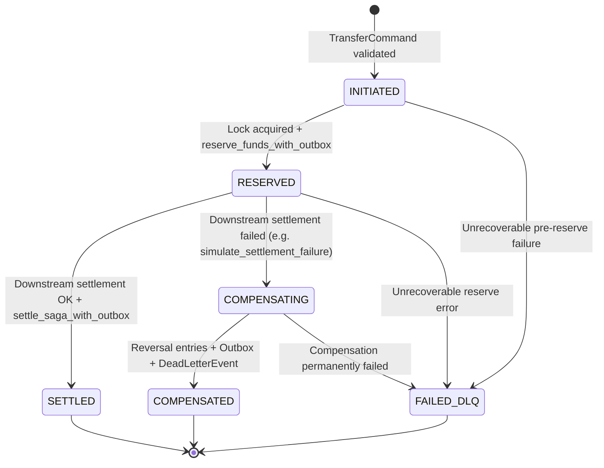

# SPEC-02: Saga, Transactional Outbox & Double-Entry Distributed Ledger Domain

> **Status**: Active  
> **Date**: 2026-11-18  
> **Branch**: `feat/saga-outbox-distributed-ledger`  
> **Owner**: `domain-architect`  
> **Scope**: Pure Domain Layer (`src/domain/`), Accounting Invariants, Distributed Saga Lifecycle, Idempotency Fingerprinting, Distributed Lock Fencing, Transactional Outbox & Consumer Deduplication

---

## 1. Objective & Architectural Boundaries

Define the pure, infrastructure-agnostic domain core of `ledgercore-distributed` using **Domain-Driven Design (DDD)**, **Clean Architecture**, and **Spec-Driven Development (SDD)**.

### Purity Constraints
- `src/domain/` MUST depend **exclusively** on the Python 3.12 standard library (`copy`, `dataclasses`, `datetime`, `enum`, `hashlib`, `json`, `re`, `threading`, `time`, `typing`).
- Zero imports from HTTP frameworks (FastAPI, Starlette, Flask), ORMs/DB drivers (SQLAlchemy, psycopg, sqlite3), Redis clients, or Kafka SDKs.
- All persistence concerns are inverted via `LedgerRepositoryProtocol` (`@runtime_checkable Protocol`).
- All domain entities and commands are immutable (`@dataclass(frozen=True)`) and self-validating (`__post_init__`), throwing explicit typed `DomainError` subclasses rather than clamping, truncating, or swallowing invalid state.

---

## 2. Exact Integer-Cent Double-Entry Accounting

### 2.1 Zero-Float Monetary Rule
- Every monetary balance and transaction amount MUST be represented as an exact Python `int` in minor units (`balance_cents`, `amount_cents`).
- Floating-point numbers (`float`), `Decimal` strings, and `bool` (which subclasses `int` in Python) MUST be strictly rejected with `InvalidTransferError`.
- Invariant checks:
  - `Account.balance_cents`: `isinstance(v, int) and not isinstance(v, bool) and v >= 0`
  - `LedgerEntry.amount_cents`: `isinstance(v, int) and not isinstance(v, bool) and v > 0`
  - `TransferCommand.amount_cents`: `isinstance(v, int) and not isinstance(v, bool) and v > 0`

### 2.2 Accounting Models
- **`EntryDirection(str, Enum)`**: `DEBIT`, `CREDIT`.
- **`Account`** (`frozen=True`):
  - Fields: `account_id: str`, `owner_name: str`, `currency: str`, `balance_cents: int`, `status: str = "ACTIVE"`, `version: int = 1`.
  - Invariants: non-empty `account_id`, `owner_name`, `status`; `currency` matches `^[A-Z]{3}$`; non-negative integer `balance_cents`; positive integer `version >= 1`.
  - Domain guard: `ensure_sufficient_funds(requested_cents: int)` validates `requested_cents > 0` and raises `InsufficientFundsError` (`ERR-422-INSUFFICIENT-FUNDS`) when `balance_cents < requested_cents`.
- **`LedgerEntry`** (`frozen=True`, append-only):
  - Fields: `entry_id: str`, `transaction_id: str`, `account_id: str`, `direction: EntryDirection`, `amount_cents: int`, `currency: str`, `entry_type: str`, `created_at: str`.
  - Append-only rule: entries are never updated or deleted; reversals are posted as new compensating double-entry pairs.

### 2.3 Zero-Sum Double-Entry Invariant
- Enforced by `DoubleEntryValidator.validate_balanced(transaction_id, entries)`:
  1. `transaction_id` MUST be a non-empty string.
  2. `entries` MUST be a `tuple[LedgerEntry, ...]` or `list[LedgerEntry]` containing at least 2 `LedgerEntry` instances (`len(entries) >= 2`); otherwise raise `ZeroSumInvariantViolationError`.
  3. Every entry in `entries` MUST belong to `transaction_id`; otherwise raise `InvalidTransferError`.
  4. Partitioned by `entry.currency`, the following equation MUST hold for every currency present:
     $$\sum_{e \in \text{DEBIT}(c)} e.\text{amount\_cents} \;=\; \sum_{e \in \text{CREDIT}(c)} e.\text{amount\_cents}$$
  5. Any imbalance raises `ZeroSumInvariantViolationError` (`ERR-500-ZERO-SUM-VIOLATION`) carrying `transaction_id`, `debit_total`, and `credit_total`.

### 2.4 Double-Entry Posting Flow per Transfer Saga
| Phase | Account Postings (Append-Only) | Zero-Sum Check |
|---|---|---|
| **Reserve (`RESERVED`)** | `DEBIT` Source Account (`amount_cents`) + `CREDIT` Clearing/Escrow Account (`amount_cents`) | `DEBIT == CREDIT` |
| **Settle (`SETTLED`)** | `DEBIT` Clearing/Escrow Account (`amount_cents`) + `CREDIT` Destination Account (`amount_cents`) | `DEBIT == CREDIT` |
| **Compensate (`COMPENSATED`)** | `DEBIT` Clearing/Escrow Account (`amount_cents`) + `CREDIT` Source Account (`amount_cents`) | `DEBIT == CREDIT` |

---

## 3. Distributed Saga Lifecycle

### 3.1 States (`SagaStatus`)
- `INITIATED`: Command accepted and validated, awaiting reservation.
- `RESERVED`: Funds atomically debited from source to escrow/clearing with outbox event recorded.
- `SETTLED`: Funds atomically credited to destination with settlement outbox event recorded (terminal success).
- `COMPENSATING`: Downstream settlement failed; reversal initiated.
- `COMPENSATED`: Reversal ledger entries posted restoring source funds, compensation outbox event recorded, and failure archived in DLQ (terminal compensated).
- `FAILED_DLQ`: Unrecoverable saga failure routed directly to Dead-Letter Queue (terminal failure).

### 3.2 State Transition Diagram


### 3.3 `SagaInstance` Invariants
- Fields: `saga_id`, `idempotency_key`, `request_fingerprint`, `source_account_id`, `destination_account_id`, `amount_cents`, `currency`, `status`, `fencing_token`, `failure_reason`, `created_at`, `updated_at`.
- `source_account_id != destination_account_id`.
- `amount_cents > 0` (exact integer, non-bool), `currency` matches `^[A-Z]{3}$`.
- `fencing_token >= 1` (exact integer, non-bool).
- `status` MUST be a valid `SagaStatus` member.

---

## 4. Idempotency-Key Replay vs Payload Conflict

### 4.1 Canonical Request Fingerprinting
`TransferCommand` computes a deterministic SHA-256 hex digest in `__post_init__` (if `request_fingerprint == ""`) over the canonical JSON serialization (`sort_keys=True`, `separators=(",", ":")`) of its semantic transfer payload:
```json
{"amount_cents":5000,"currency":"USD","destination_account_id":"acc-bob","simulate_settlement_failure":false,"source_account_id":"acc-alice"}
```

### 4.2 Replay & Conflict Semantics
1. Look up existing record via `LedgerRepositoryProtocol.get_idempotency_record(command.idempotency_key)`.
2. **Not found**: proceed with distributed lock acquisition and new Saga creation.
3. **Found & `existing.request_fingerprint == command.request_fingerprint`**:
   - **Safe Idempotent Replay**: return the existing `SagaInstance` without debiting accounts, creating duplicate ledger entries, or emitting duplicate outbox events.
4. **Found & `existing.request_fingerprint != command.request_fingerprint`**:
   - **Payload Conflict**: raise `IdempotencyConflictError` (`ERR-409-IDEMPOTENCY-CONFLICT`) with `idempotency_key`.

---

## 5. Distributed Lock Fencing & Transactional Outbox + Kafka Deduplication

### 5.1 Distributed Lock Fencing (`DistributedLockManager`)
- Thread-safe Redlock-style distributed mutex protecting critical resources (e.g., `account:{source_account_id}`).
- `acquire(resource_key: str, owner: str, ttl_seconds: float | None = None) -> int`:
  - Issues a globally monotonically increasing integer `fencing_token` (`1, 2, 3, ...`) on every successful acquisition.
  - If `resource_key` is currently locked by a **different** `owner` (and not expired), raises `DistributedLockContentionError` (`ERR-409-LOCK-CONTENTION`).
  - Fencing tokens are persisted on `SagaInstance` and passed into repository write operations so stale lock holders (e.g., after a GC pause) cannot overwrite newer state.
- `release(resource_key: str, owner: str) -> None`:
  - Releases the lock if held by `owner`; no-op if already released/expired; raises `DistributedLockContentionError` if currently held by a different `owner`.
- `active_locks() -> dict[str, dict[str, Any]]`:
  - Returns a defensive snapshot of all non-expired active locks (`owner`, `fencing_token`, `acquired_at`).

### 5.2 Transactional Outbox (`OutboxEvent` & `DeadLetterEvent`)
- Eliminates the database/broker dual-write problem: every state mutation (`reserve_funds_with_outbox`, `settle_saga_with_outbox`, `compensate_saga_with_outbox`) persists state changes, double-entry `LedgerEntry` rows, and `OutboxEvent` rows (`status = OutboxStatus.PENDING`) in the **same atomic transaction**.
- `OutboxStatus`: `PENDING`, `PUBLISHED`, `DEAD_LETTERED`.
- `OutboxEvent` invariants: valid JSON `payload_json`, non-negative integer `retry_count`, and non-empty `published_at` whenever `status == OutboxStatus.PUBLISHED`.
- `DeadLetterEvent` archives failed settlement or unpublishable events (`dlq_id`, `event_id`, `topic`, `reason`, `payload_json`, `failed_at`) with valid JSON `payload_json`.

### 5.3 Partitioned Broker & Effectively-Once Consumer Deduplication (`InMemoryKafkaBroker`)
- Models `at-least-once` delivery over partitioned topic logs (`num_partitions >= 1`, default `4`).
- `publish(topic, event_id, event_type, payload) -> dict`:
  - Deterministic SHA-256 partition selection using `payload["aggregate_id"]`, `payload["saga_id"]`, or `event_id`.
  - Monotonic per-`(topic, partition)` offsets; stores defensive deep copies of payloads.
- `consume_idempotent(consumer_group, event_id) -> bool`:
  - Thread-safe consumer deduplication registry keyed by `(consumer_group, event_id)`.
  - First delivery returns `True` (consumer applies side effect); any duplicate redelivery returns `False` (safely ignored), achieving **effectively-once** state semantics on top of `at-least-once` transport.
- `list_topic_events(topic=None, limit=100) -> list[dict]`:
  - Returns defensive deep copies of up to the most recent `limit` published events (chronological order), optionally filtered by `topic`.

---

## 6. Domain Exception Taxonomy

| Exception Class | Error Code | Structured Attributes | Semantic Meaning |
|---|---|---|---|
| `DomainError` | `ERR-400-DOMAIN-ERROR` | `message`, `code`, `details` | Base typed domain error |
| `InvalidTransferError` | `ERR-400-INVALID-TRANSFER` | `message`, `code`, `details` | Malformed command, negative/float/bool cents, same-account transfer, invalid invariant |
| `AccountNotFoundError` | `ERR-404-ACCOUNT-NOT-FOUND` | `account_id`, `code` | Referenced account does not exist |
| `InsufficientFundsError` | `ERR-422-INSUFFICIENT-FUNDS` | `account_id`, `available_cents`, `requested_cents`, `code` | Source account balance below requested transfer amount |
| `IdempotencyConflictError` | `ERR-409-IDEMPOTENCY-CONFLICT` | `idempotency_key`, `code` | Idempotency key reused with a mismatched SHA-256 request fingerprint |
| `DistributedLockContentionError` | `ERR-409-LOCK-CONTENTION` | `resource_key`, `code` | Resource mutex currently held by another owner |
| `ZeroSumInvariantViolationError` | `ERR-500-ZERO-SUM-VIOLATION` | `transaction_id`, `debit_total`, `credit_total`, `code` | Double-entry transaction does not balance to zero per currency |

---

## 7. Repository Port Contract (`LedgerRepositoryProtocol`)

`@runtime_checkable class LedgerRepositoryProtocol(Protocol)` defines the strict persistence boundary implemented by `data-architect`:

- `list_accounts() -> list[Account]`
- `get_account(account_id: str) -> Account | None`
- `get_idempotency_record(idempotency_key: str) -> SagaInstance | None`
- `reserve_funds_with_outbox(command: TransferCommand, saga_id: str, fencing_token: int) -> SagaInstance`
- `settle_saga_with_outbox(saga_id: str, fencing_token: int) -> SagaInstance`
- `compensate_saga_with_outbox(saga_id: str, fencing_token: int, failure_reason: str) -> SagaInstance`
- `list_pending_outbox_events(limit: int = 50) -> list[OutboxEvent]`
- `mark_outbox_published(event_id: str) -> None`
- `list_outbox_events(limit: int = 100) -> list[OutboxEvent]`
- `list_sagas(limit: int = 100) -> list[SagaInstance]`
- `list_ledger_entries(transaction_id: str | None = None, limit: int = 200) -> list[LedgerEntry]`
- `list_dead_letter_events(limit: int = 100) -> list[DeadLetterEvent]`

---

## 8. Acceptance Criteria

1. Importing `src.domain` requires zero third-party packages and succeeds under stock Python 3.12.
2. `Account`, `LedgerEntry`, `TransferCommand`, `SagaInstance`, `OutboxEvent`, and `DeadLetterEvent` are frozen dataclasses that reject invalid types (`float`, `bool`, empty strings, invalid currency codes, non-positive amounts, same-account transfers, invalid JSON).
3. `DoubleEntryValidator.validate_balanced` accepts balanced multi-entry transactions and rejects single-entry, empty, mismatched-transaction, cross-currency imbalanced, or unequal DEBIT/CREDIT postings with `ZeroSumInvariantViolationError`.
4. `TransferCommand` generates deterministic identical SHA-256 fingerprints for identical payloads and distinct fingerprints when any payload attribute changes.
5. `DistributedLockManager` issues strictly monotonically increasing fencing tokens, blocks competing owners with `DistributedLockContentionError`, protects ownership on release, and is thread-safe under concurrent acquisition.
6. `InMemoryKafkaBroker` guarantees deterministic partitioning, monotonic per-partition offsets, thread-safe publication, and effectively-once `consume_idempotent` deduplication per consumer group.
7. `LedgerRepositoryProtocol` is `@runtime_checkable` and declares all 12 required repository operations.
