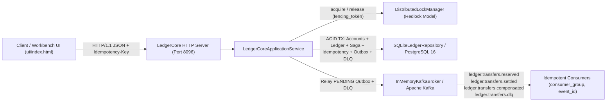
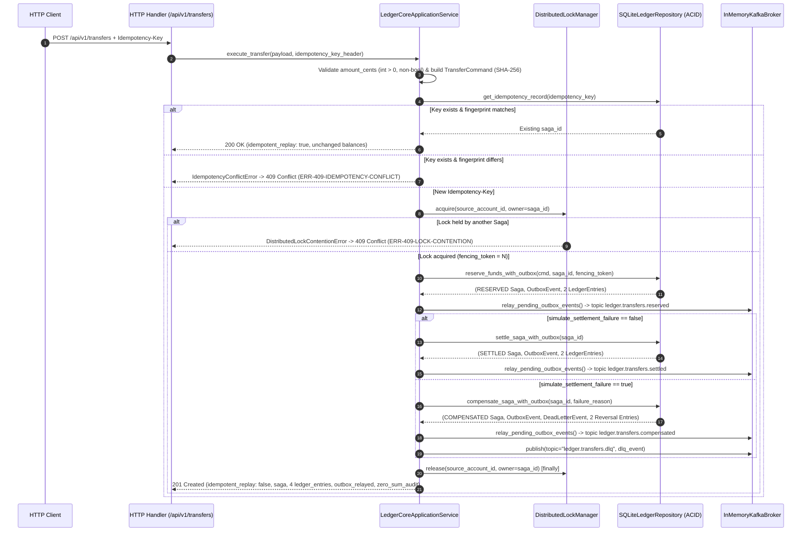

# SPEC-03: Saga REST API, Transactional Outbox Relay & Java 21 Enterprise Blueprint

> **Status**: Active  
> **Date**: 2026-11-18  
> **Branch**: `feat/saga-outbox-distributed-ledger`  
> **Owner**: `integration-architect`  
> **Scope**: Application Orchestration (`src/application/`), HTTP/1.1 REST API (`src/interfaces/http/`), Outbox-to-Kafka Relay, Semantic Error Mapping, and Java 21 + Spring Boot 3 Microservice Blueprint (`java-service/`)

---

## 1. Objective & Integration Boundaries

Connect the pure double-entry accounting & Saga domain (`src/domain/`) and the ACID SQLite/PostgreSQL Transactional Outbox repository (`src/infrastructure/persistence/`) to external HTTP clients, the interactive workbench UI (`ui/index.html`), and partitioned event streams (`InMemoryKafkaBroker` / Apache Kafka).

### Architectural Rules
1. **Strict Typed DTO Contracts**: Every request and response payload uses deterministic, explicit field names and exact integer cents (`amount_cents`, `balance_cents`). Floating-point monetary values and booleans masquerading as integers are strictly rejected.
2. **Zero Stack-Trace Leakage**: All domain, validation, concurrency, and unexpected runtime errors are mapped to structured JSON error envelopes with semantic HTTP status codes (`400`, `404`, `409`, `413`, `422`, `500`) without exposing internal tracebacks or filesystem paths.
3. **End-to-End Idempotency & Fencing**: `POST /api/v1/transfers` enforces `Idempotency-Key` SHA-256 fingerprint verification before and under distributed mutex acquisition (`DistributedLockManager`), emitting monotonic fencing tokens into every Saga mutation.
4. **Atomic Outbox Relay**: Pending `outbox_events` rows created atomically during `RESERVE`, `SETTLE`, and `COMPENSATE` are relayed FIFO to Kafka topics and marked `PUBLISHED` only after broker acknowledgement. Failed settlement paths additionally archive and publish Dead-Letter Queue (`ledger.transfers.dlq`) diagnostics.
5. **Security Boundary Hardening**: Request bodies are strictly bounded at `MAX_JSON_BODY_BYTES = 64 * 1024` (64 KB), and all HTTP responses emit `X-Content-Type-Options: nosniff`, `X-Frame-Options: DENY`, `Referrer-Policy: no-referrer`, and explicit CORS headers supporting `Idempotency-Key`.

---

## 2. System Integration Architecture



---

## 3. End-to-End Transfer Saga Orchestration Sequence



---

## 4. REST API v1 Endpoint & DTO Contracts

All JSON endpoints use `Content-Type: application/json; charset=utf-8`. Static workbench HTML is served at `GET /` and `GET /ui` from `ui/index.html`.

### 4.1 `GET /api/v1/health`
Returns liveness, repository telemetry, active distributed lock counts, monotonic fencing counter, and global zero-sum audit summary.

- **Status**: `200 OK`
- **Response DTO**:
```json
{
  "status": "ok",
  "service": "ledgercore-distributed",
  "environment": "development",
  "accounts_count": 5,
  "sagas_count": 2,
  "pending_outbox_count": 0,
  "dlq_count": 1,
  "active_locks_count": 0,
  "current_fencing_token": 2,
  "zero_sum_balanced": true,
  "zero_sum_audit": {
    "total_entries": 8,
    "total_debits_cents": 200000,
    "total_credits_cents": 200000,
    "imbalance_cents": 0,
    "is_balanced": true,
    "by_currency": {
      "USD": {
        "debits_cents": 200000,
        "credits_cents": 200000,
        "imbalance_cents": 0,
        "is_balanced": true
      }
    },
    "audited_at": "2026-11-18T22:45:00+00:00"
  },
  "timestamp": "2026-11-18T22:45:00+00:00"
}
```

### 4.2 `GET /api/v1/accounts`
Returns all persisted ledger accounts ordered deterministically by `account_id`.

- **Status**: `200 OK`
- **Response DTO**:
```json
{
  "accounts": [
    {
      "account_id": "ACC-TREASURY-001",
      "owner_name": "Core Treasury Reserve",
      "currency": "USD",
      "balance_cents": 50000000,
      "status": "ACTIVE",
      "version": 1
    }
  ],
  "total": 5
}
```

### 4.3 `POST /api/v1/transfers`
Executes a distributed double-entry transfer Saga guarded by `Idempotency-Key` and distributed lock fencing.

- **Headers**:
  - `Content-Type: application/json`
  - `Idempotency-Key: <string>` *(optional if provided in JSON body `idempotency_key`; header takes precedence when present)*
- **Request DTO**:
```json
{
  "idempotency_key": "idem-tx-001",
  "source_account_id": "ACC-TREASURY-001",
  "destination_account_id": "ACC-MERCHANT-002",
  "amount_cents": 150000,
  "currency": "USD",
  "simulate_settlement_failure": false
}
```
- **Validation Rules**:
  - `idempotency_key` (header or body): non-empty string.
  - `source_account_id`, `destination_account_id`: non-empty strings, MUST be distinct.
  - `amount_cents`: strict positive integer (`isinstance(v, int) and not isinstance(v, bool) and v >= 1`).
  - `currency`: 3-letter uppercase ISO-4217 code (default `"USD"`).
  - `simulate_settlement_failure`: strict boolean (default `false`).
- **Response DTO — New Transfer (`201 Created`)**:
```json
{
  "idempotent_replay": false,
  "saga": {
    "saga_id": "SAGA-A1B2C3D4E5F6",
    "idempotency_key": "idem-tx-001",
    "request_fingerprint": "<64-char sha256 hex>",
    "source_account_id": "ACC-TREASURY-001",
    "destination_account_id": "ACC-MERCHANT-002",
    "amount_cents": 150000,
    "currency": "USD",
    "status": "SETTLED",
    "fencing_token": 1,
    "failure_reason": null,
    "created_at": "2026-11-18T22:45:00+00:00",
    "updated_at": "2026-11-18T22:45:00+00:00"
  },
  "ledger_entries": [
    {
      "entry_id": "ENT-...",
      "transaction_id": "SAGA-A1B2C3D4E5F6",
      "account_id": "ACC-TREASURY-001",
      "direction": "DEBIT",
      "amount_cents": 150000,
      "currency": "USD",
      "entry_type": "TRANSFER_RESERVE",
      "created_at": "..."
    }
  ],
  "outbox_relayed": [
    {
      "topic": "ledger.transfers.reserved",
      "partition": 2,
      "offset": 0,
      "event_id": "EVT-...",
      "event_type": "TransferFundsReserved",
      "payload": {},
      "published_at": "..."
    }
  ],
  "zero_sum_audit": {
    "total_entries": 4,
    "total_debits_cents": 300000,
    "total_credits_cents": 300000,
    "imbalance_cents": 0,
    "is_balanced": true,
    "by_currency": {},
    "audited_at": "..."
  }
}
```
  *(When `simulate_settlement_failure` is `true`, `status` is `"COMPENSATED"`, `failure_reason` is `"Downstream settlement partner timeout — auto-compensated"`, `dlq_event` is included, and both `ledger.transfers.compensated` and `ledger.transfers.dlq` events are published to Kafka.)*

- **Response DTO — Safe Idempotent Replay (`200 OK`)**:
```json
{
  "idempotent_replay": true,
  "saga": { "...existing SagaInstance..." },
  "ledger_entries": [ "...existing 4 LedgerEntries..." ],
  "outbox_relayed": [],
  "zero_sum_audit": { "...global audit..." }
}
```

### 4.4 `GET /api/v1/sagas`
Lists persisted transfer Sagas ordered from newest to oldest. Supports optional `?limit=<int>` (default `100`, max `500`).

- **Status**: `200 OK`
- **Response DTO**: `{ "sagas": [SagaInstanceDTO], "total": <int> }`

### 4.5 `GET /api/v1/sagas/{saga_id}`
Returns a single Saga snapshot along with its double-entry journal lines. Raises `AccountNotFoundError` (`404 Not Found`) if `{saga_id}` does not exist.

- **Status**: `200 OK` (or `404 Not Found`)
- **Response DTO**:
```json
{
  "saga_id": "SAGA-...",
  "idempotency_key": "...",
  "request_fingerprint": "...",
  "source_account_id": "...",
  "destination_account_id": "...",
  "amount_cents": 150000,
  "currency": "USD",
  "status": "SETTLED",
  "fencing_token": 1,
  "failure_reason": null,
  "created_at": "...",
  "updated_at": "...",
  "saga": { "...same SagaInstanceDTO..." },
  "ledger_entries": [ "...LedgerEntryDTO[]" ]
}
```

### 4.6 `GET /api/v1/ledger/entries`
Lists append-only double-entry journal lines. Supports optional `?transaction_id=<saga_id>` and `?limit=<int>` (default `200`, max `500`).

- **Status**: `200 OK`
- **Response DTO**: `{ "entries": [LedgerEntryDTO], "ledger_entries": [LedgerEntryDTO], "total": <int> }`

### 4.7 `GET /api/v1/ledger/audit`
Executes a real-time global and per-currency double-entry zero-sum verification across `ledger_entries`.

- **Status**: `200 OK`
- **Response DTO**: `ZeroSumAuditDTO` (`total_entries`, `total_debits_cents`, `total_credits_cents`, `imbalance_cents`, `is_balanced`, `by_currency`, `audited_at`).

### 4.8 `GET /api/v1/outbox`
Lists Transactional Outbox events ordered newest to oldest (`PENDING`, `PUBLISHED`, `DEAD_LETTERED`). Supports optional `?limit=<int>`.

- **Status**: `200 OK`
- **Response DTO**: `{ "events": [OutboxEventDTO], "outbox_events": [OutboxEventDTO], "total": <int> }`

### 4.9 `POST /api/v1/outbox/relay`
Triggers an explicit FIFO sweep of all `PENDING` outbox rows, publishes each to Kafka, and marks them `PUBLISHED`. Accepts empty body or `{}`.

- **Status**: `200 OK`
- **Response DTO**: `{ "relayed": [KafkaRecordDTO], "relayed_count": <int> }`

### 4.10 `GET /api/v1/kafka/events`
Lists published Kafka topic records in chronological order. Supports optional `?topic=<topic_name>` and `?limit=<int>`.

- **Status**: `200 OK`
- **Response DTO**: `{ "events": [KafkaRecordDTO], "kafka_events": [KafkaRecordDTO], "topic": "<string|null>", "total": <int> }`

### 4.11 `GET /api/v1/dlq`
Lists persisted Dead-Letter Queue records from failed settlement compensations. Supports optional `?limit=<int>`.

- **Status**: `200 OK`
- **Response DTO**: `{ "events": [DeadLetterEventDTO], "dlq_events": [DeadLetterEventDTO], "total": <int> }`

---

## 5. Semantic HTTP Status & Error Contract Mapping

All non-2xx error responses conform to a uniform envelope and **never** include stack traces, SQL strings, or host paths:

```json
{
  "error": {
    "code": "ERR-409-IDEMPOTENCY-CONFLICT",
    "type": "IdempotencyConflictError",
    "message": "Human-readable domain explanation",
    "details": {}
  }
}
```

| Scenario / Exception Class | HTTP Status | Error Code |
|---|---|---|
| New transfer executed (`SETTLED` or `COMPENSATED`) | `201 Created` | N/A (`idempotent_replay: false`) |
| Duplicate `Idempotency-Key` + matching SHA-256 fingerprint | `200 OK` | N/A (`idempotent_replay: true`) |
| `InvalidTransferError` (invalid amount, float/bool, same account, currency mismatch, invalid query params) | `400 Bad Request` | `ERR-400-INVALID-TRANSFER` |
| `MalformedJsonError` (invalid UTF-8, broken JSON, non-object body, missing body) | `400 Bad Request` | `ERR-400-MALFORMED-JSON` |
| `AccountNotFoundError` (missing source/destination/escrow account or missing `saga_id`) | `404 Not Found` | `ERR-404-ACCOUNT-NOT-FOUND` |
| Unmatched HTTP route | `404 Not Found` | `ERR-404-ROUTE-NOT-FOUND` |
| `IdempotencyConflictError` (reused `Idempotency-Key` with different payload fingerprint) | `409 Conflict` | `ERR-409-IDEMPOTENCY-CONFLICT` |
| `DistributedLockContentionError` (concurrent lock held by another Saga owner) | `409 Conflict` | `ERR-409-LOCK-CONTENTION` |
| `PayloadTooLargeError` (request body `> 65536` bytes) | `413 Payload Too Large` | `ERR-413-PAYLOAD-TOO-LARGE` |
| `InsufficientFundsError` (source account `balance_cents < amount_cents`) | `422 Unprocessable Entity` | `ERR-422-INSUFFICIENT-FUNDS` |
| `ZeroSumInvariantViolationError` | `500 Internal Server Error` | `ERR-500-ZERO-SUM-VIOLATION` |
| Any unhandled unexpected `Exception` | `500 Internal Server Error` | `ERR-500-INTERNAL-ERROR` |

---

## 6. Kafka Event Topics & Schema

| Topic | Event Type | Trigger | Partition Key |
|---|---|---|---|
| `ledger.transfers.reserved` | `TransferFundsReserved` | Step 1 ACID reserve | `aggregate_id` (`saga_id`) |
| `ledger.transfers.settled` | `TransferSettled` | Step 2 ACID settlement | `aggregate_id` (`saga_id`) |
| `ledger.transfers.compensated` | `TransferCompensated` | Step 2 ACID compensation reversal | `aggregate_id` (`saga_id`) |
| `ledger.transfers.dlq` | `TransferDeadLettered` | Settlement failure quarantined to DLQ | `aggregate_id` (`saga_id`) |

---

## 7. Java 21 + Spring Boot 3 Enterprise Microservice Blueprint (`java-service/`)

To demonstrate enterprise JVM production parity alongside the zero-dependency Python 3.12 runtime, `java-service/` provides a clean Spring Boot 3.3 + Java 21 service blueprint aligned table-for-table with `migrations/001_init_ledgercore_outbox.sql`:

- `java-service/pom.xml`: Java 21, Spring Boot 3.3, Spring Data JPA, Spring Kafka, Spring Data Redis, Bean Validation, Flyway (PostgreSQL), and Testcontainers (PostgreSQL + Kafka).
- `com.ledgercore.domain.LedgerEntry`: Immutable JPA entity mapped to `ledger_entries` with exact `long amountCents` minor units and zero-sum validation.
- `com.ledgercore.domain.OutboxEvent`: JPA entity mapped to `outbox_events` with `PENDING -> PUBLISHED | DEAD_LETTERED` lifecycle transitions.
- `com.ledgercore.application.TransferSagaOrchestrator`: `@Service` combining Redis distributed lock fencing, SHA-256 idempotency verification, `@Transactional` double-entry reserve/settle/compensate + outbox writes, and Kafka outbox relay.
- `com.ledgercore.interfaces.TransferController`: `@RestController` exposing `/api/v1/transfers` with `@Valid` DTO contracts, `Idempotency-Key` header support, and `@ExceptionHandler` semantic HTTP mapping (`400`, `404`, `409`, `422`).

---

## 8. Acceptance Criteria

1. `create_http_server("127.0.0.1", 0)` boots cleanly with zero third-party packages under Python 3.12 and auto-seeds all 5 default accounts.
2. Normal `POST /api/v1/transfers` returns `201 Created`, `idempotent_replay: false`, `saga.status == "SETTLED"`, 4 balanced ledger entries, relayed Kafka events on `ledger.transfers.reserved` and `ledger.transfers.settled`, and `zero_sum_audit.is_balanced == True`.
3. Re-submitting the identical `Idempotency-Key` and payload returns `200 OK`, `idempotent_replay: true`, identical `saga_id`, and zero balance drift.
4. Reusing the same `Idempotency-Key` with a mutated payload returns `409 Conflict` with `error.code == "ERR-409-IDEMPOTENCY-CONFLICT"`.
5. Requesting more than available source balance returns `422 Unprocessable Entity` with `error.code == "ERR-422-INSUFFICIENT-FUNDS"`.
6. Setting `simulate_settlement_failure: true` returns `201 Created`, `saga.status == "COMPENSATED"`, source balance restored via append-only `SAGA_COMPENSATION` entries, zero-sum audit balanced, and a DLQ record both in `/api/v1/dlq` and Kafka topic `ledger.transfers.dlq`.
7. All responses include `X-Content-Type-Options: nosniff`, `X-Frame-Options: DENY`, `Referrer-Policy: no-referrer`, and CORS headers; bodies exceeding 64 KB are rejected with `413 Payload Too Large`; no stack traces ever leak.
