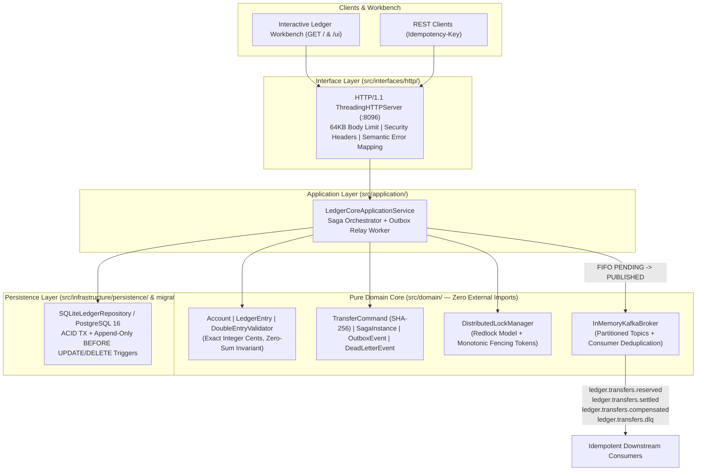

# LedgerCore Distributed

> **Distributed Double-Entry Accounting Engine with Orchestrated Sagas, Transactional Outbox Relay, SHA-256 Idempotency Keys, Distributed Lock Fencing, and Dead-Letter Queue Compensation.**

Built under **Spec-Driven Development (SDD)**, **Clean Architecture**, and **Domain-Driven Design (DDD)**. Runs out-of-the-box on **Python 3.12 standard library (zero external dependencies)** with full SQLite ACID triggers + in-memory Kafka broker for instant local evaluation, paired with production **PostgreSQL 16 migrations** and a **Java 21 + Spring Boot 3.3 enterprise microservice blueprint** (`java-service/`).

---

## Architecture Overview



---

## Core Engineering Guarantees

| Capability | Implementation | Invariant / Proof |
|---|---|---|
| **Exact Integer-Cent Double-Entry** | `src/domain/ledger.py`, `DoubleEntryValidator` | Floats & booleans rejected (`400`); every transaction satisfies `SUM(DEBIT) == SUM(CREDIT)` per currency |
| **Database-Enforced Append-Only Ledger** | `migrations/001_init_ledgercore_outbox.sql`, `SQLiteLedgerRepository` | `BEFORE UPDATE` & `BEFORE DELETE` triggers raise `APPEND_ONLY_LEDGER_VIOLATION`; reversals append `SAGA_COMPENSATION` entries |
| **Transactional Outbox Pattern** | `reserve_funds_with_outbox`, `settle_saga_with_outbox`, `compensate_saga_with_outbox` | Balance updates, ledger lines, Saga state, idempotency record, and `PENDING` outbox event commit in **1 ACID transaction** |
| **SHA-256 Idempotency Keys** | `TransferCommand.compute_fingerprint`, `idempotency_records` | Identical retry -> `200 OK` (`idempotent_replay: true`, zero balance drift); mutated payload -> `409 Conflict` (`ERR-409-IDEMPOTENCY-CONFLICT`) |
| **Distributed Lock Fencing** | `DistributedLockManager` (Python) / Redis Lua script (Java) | Exclusive per-account mutex issuing monotonically increasing `fencing_token`; competing callers receive `409 Conflict` (`ERR-409-LOCK-CONTENTION`) |
| **Saga Compensation & DLQ** | `simulate_settlement_failure: true` | Automatic escrow reversal restores source funds (`status: COMPENSATED`), keeps global audit balanced, and publishes to `ledger.transfers.dlq` |
| **Java 21 + Spring Boot 3 Parity** | `java-service/` | Production enterprise blueprint with Spring Data JPA, Spring Kafka, Redis Lua locking, Flyway PostgreSQL, and Testcontainers |

---

## 1-Command Quick Start

### Option A: Local Zero-Dependency Runtime (Python 3.12+)

```bash
python -m src.main
```

The server starts on **`http://127.0.0.1:8096`**, auto-seeds 5 deterministic accounts (`ACC-TREASURY-001`, `ACC-MERCHANT-002`, `ACC-CUSTOMER-003`, `ACC-SETTLEMENT-004`, `ACC-ESCROW-CLEARING`), and serves the interactive workbench at `http://127.0.0.1:8096/`.

### Option B: Full Containerized Stack (PostgreSQL 16 + Redis 7 + Apache Kafka 3.8 + LedgerCore)

```bash
docker compose up --build
```

For isolated development with hot-mounted source code, use:

```bash
docker compose -f docker-compose.dev.yml up
```

---

## REST API v1 Endpoints

| Method & Path | Description | Success Status |
|---|---|---|
| `GET /` or `GET /ui` | Interactive LedgerCore Distributed Workbench UI | `200 OK` |
| `GET /api/v1/health` | Service health, lock telemetry, fencing counter & zero-sum status | `200 OK` |
| `GET /api/v1/accounts` | List all accounts with integer-cent balances & optimistic versions | `200 OK` |
| `POST /api/v1/transfers` | Execute transfer Saga (`Idempotency-Key` header or body field) | `201 Created` / `200 OK` (replay) |
| `GET /api/v1/sagas` | List transfer Sagas (newest first, supports `?limit=`) | `200 OK` |
| `GET /api/v1/sagas/{saga_id}` | Inspect Saga snapshot and its double-entry journal lines | `200 OK` / `404 Not Found` |
| `GET /api/v1/ledger/entries` | List append-only ledger entries (`?transaction_id=&limit=`) | `200 OK` |
| `GET /api/v1/ledger/audit` | Global & per-currency `SUM(DEBIT) == SUM(CREDIT)` zero-sum audit | `200 OK` |
| `GET /api/v1/outbox` | Inspect Transactional Outbox events (`PENDING` / `PUBLISHED`) | `200 OK` |
| `POST /api/v1/outbox/relay` | Manually trigger FIFO sweep of `PENDING` outbox events to Kafka | `200 OK` |
| `GET /api/v1/kafka/events` | Inspect partitioned Kafka topic log (`?topic=&limit=`) | `200 OK` |
| `GET /api/v1/dlq` | Inspect quarantined Dead-Letter Queue settlement failures | `200 OK` |

### Semantic Error Mapping

| HTTP Status | Error Code | Trigger |
|---|---|---|
| `400 Bad Request` | `ERR-400-INVALID-TRANSFER` / `ERR-400-MALFORMED-JSON` | Non-positive/float/bool cents, same-account transfer, malformed JSON |
| `404 Not Found` | `ERR-404-ACCOUNT-NOT-FOUND` | Non-existent account ID or unknown `saga_id` |
| `409 Conflict` | `ERR-409-IDEMPOTENCY-CONFLICT` | Same `Idempotency-Key` reused with a different request payload |
| `409 Conflict` | `ERR-409-LOCK-CONTENTION` | Source account mutex held concurrently by another Saga |
| `413 Payload Too Large` | `ERR-413-PAYLOAD-TOO-LARGE` | Request body exceeds `65536` bytes (64 KB) |
| `422 Unprocessable Entity` | `ERR-422-INSUFFICIENT-FUNDS` | Source account balance is lower than `amount_cents` |

### Quick `curl` Walkthrough

```bash
# 1. Execute a new $1,500.00 transfer (201 Created -> SETTLED)
curl -X POST http://127.0.0.1:8096/api/v1/transfers \
  -H "Content-Type: application/json" \
  -H "Idempotency-Key: demo-tx-001" \
  -d '{"source_account_id":"ACC-TREASURY-001","destination_account_id":"ACC-MERCHANT-002","amount_cents":150000,"currency":"USD"}'

# 2. Safe idempotent replay (200 OK -> idempotent_replay: true, zero balance change)
curl -X POST http://127.0.0.1:8096/api/v1/transfers \
  -H "Content-Type: application/json" \
  -H "Idempotency-Key: demo-tx-001" \
  -d '{"source_account_id":"ACC-TREASURY-001","destination_account_id":"ACC-MERCHANT-002","amount_cents":150000,"currency":"USD"}'

# 3. Trigger simulated settlement failure & automatic compensation + DLQ (201 Created -> COMPENSATED)
curl -X POST http://127.0.0.1:8096/api/v1/transfers \
  -H "Content-Type: application/json" \
  -H "Idempotency-Key: demo-tx-002" \
  -d '{"source_account_id":"ACC-TREASURY-001","destination_account_id":"ACC-SETTLEMENT-004","amount_cents":75000,"currency":"USD","simulate_settlement_failure":true}'

# 4. Verify mathematical zero-sum balance across the entire ledger
curl http://127.0.0.1:8096/api/v1/ledger/audit
```

---

## Java 21 + Spring Boot 3 Enterprise Blueprint

Located under [`java-service/`](java-service/), providing a production JVM counterpart aligned table-for-table with [`migrations/001_init_ledgercore_outbox.sql`](migrations/001_init_ledgercore_outbox.sql):

- [`java-service/pom.xml`](java-service/pom.xml) — Java 21, Spring Boot 3.3.5, Spring Data JPA, Spring Kafka, Spring Data Redis, Flyway PostgreSQL, Testcontainers (PostgreSQL + Kafka).
- [`LedgerEntry.java`](java-service/src/main/java/com/ledgercore/domain/LedgerEntry.java) — `@Immutable` append-only double-entry entity with exact `long amountCents` and `validateBalanced(...)`.
- [`OutboxEvent.java`](java-service/src/main/java/com/ledgercore/domain/OutboxEvent.java) — Transactional Outbox entity with `PENDING -> PUBLISHED | DEAD_LETTERED` lifecycle transitions.
- [`TransferSagaOrchestrator.java`](java-service/src/main/java/com/ledgercore/application/TransferSagaOrchestrator.java) — Redis Lua compare-and-delete distributed lock + monotonic fencing token + `@Transactional` reserve/settle/compensate + `@Scheduled` Kafka outbox relay.
- [`TransferController.java`](java-service/src/main/java/com/ledgercore/interfaces/TransferController.java) — `@RestController` with Bean Validation DTOs, `Idempotency-Key` header handling, and `@ExceptionHandler` semantic HTTP mapping.

---

## Repository Layout & Documentation

- `.specs/` — Spec-Driven Development specifications (domain, data/outbox, integration API).
- `docs/adr/001-transactional-outbox-over-2pc.md` — Why Transactional Outbox & Orchestrated Sagas over 2PC/XA.
- `docs/adr/002-idempotency-keys-and-double-entry-compensation.md` — SHA-256 idempotency fingerprinting & append-only double-entry reversals.
- `migrations/001_init_ledgercore_outbox.sql` — PostgreSQL 16 schema with `BEFORE UPDATE/DELETE` immutability triggers.
- `src/domain/` — Pure zero-dependency accounting, Saga, fencing lock, and broker domain core.
- `src/infrastructure/persistence/` — Thread-safe SQLite ACID repository + deterministic dev account seeder.
- `src/application/` — `LedgerCoreApplicationService` orchestrator & outbox relay.
- `src/interfaces/http/` — Zero-dependency HTTP/1.1 REST server (`port 8096`).
- `java-service/` — Java 21 + Spring Boot 3.3 enterprise microservice blueprint.

---

## Verification & Testing

```bash
python -m unittest discover -s tests -v
```
